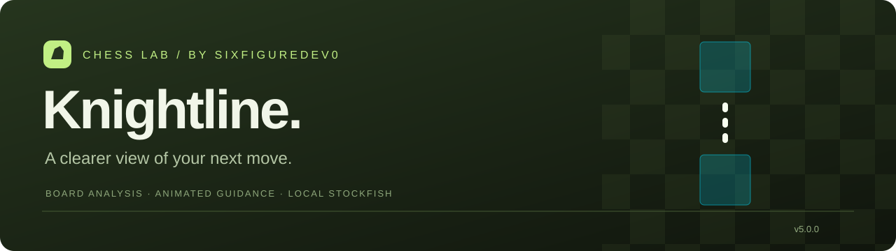
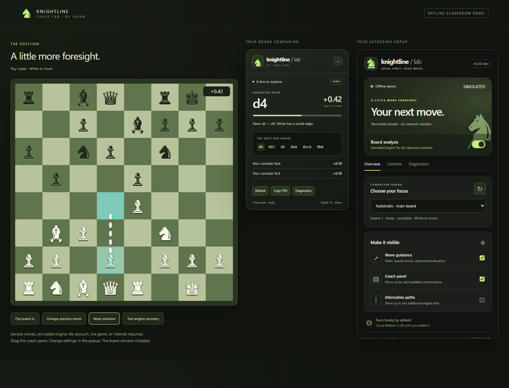

<p align="center"></p>
<p align="center"><strong>Manifest V3</strong> · <strong>Local Stockfish</strong> · <strong>5.0 development candidate</strong> · <a href="LICENSE">GPLv3</a></p>
<p align="center"><a href="#try-the-candidate">Install</a> / <a href="#how-it-works">Features</a> / <a href="docs/ACCEPTANCE.md">Verification status</a> / <a href="docs/ARCHITECTURE.md">Architecture</a> / <a href="PRIVACY.md">Privacy</a></p>

# Knightline · Chess Lab

A self-contained chess extension for desktop Chrome and Edge. Knightline reads a Chess.com or Lichess board, analyses it with bundled Stockfish, checks each suggested move against the current position, and draws a clear path across the board. Built by [sixfiguredev0](https://github.com/sixfiguredev0) for a programming-class project.

**5.0 is under verification.** This branch does not replace the published release. The reported 4.8.2 position now passes real offline analysis. The affected installation must still successfully repeat the live-board workflow before release. See the [acceptance ledger](docs/ACCEPTANCE.md) for the difference between controlled fixtures, public-site checks, and tests still pending.



*This preview is the labelled classroom demo with a simulated engine. The installed extension runs the bundled real WASM engine.*

## How it works

- **Analysis on your device.** One Stockfish.js 19.0.1 lite Worker, one thread, a 32 MB hash, and three candidate lines. No account, key, subscription, or hosting required. The Worker is released after 60 idle seconds.
- **A board you choose.** Site adapters prefer the main board and exclude miniatures. Ambiguous boards require an explicit selection. Orientation and player colour are tracked separately.
- **Positions with provenance.** Matching complete FEN, legal move-history replay, and observed transitions preserve known state. Missing history is disclosed. Turn and complete-FEN corrections are available; unknown castling rights are omitted.
- **Guidance with detail.** White dashed paths, orange practice variations, castling rook paths, promotion indicators, optional alternative paths, and White-perspective evaluation. The charcoal and green coach panel moves, collapses, and remembers its position.
- **Explicit gameplay controls.** Autoplay, click or drag input, fixed or bounded randomized delays, and depth-2 or bounded-loss variations. Settings apply across contexts. Known read-only boards report their limitation. Submitted input is verified against the expected legal transition.
- **Interruptions handled.** Board changes, navigation, manual input, disablement, and game end cancel obsolete work. Position and request identities prevent stale results from replacing a newer position.
- **Inspectible failures.** Diagnostics expose installed version, selected board, FEN stages, engine result, and input rejection. Copied reports exclude account fields and page URLs, and redact URLs, paths, and email-like strings from errors.

## Compatibility and verification

Initial scope: standard chess on desktop Chromium browsers with Manifest V3 offscreen support, Chrome/Edge 116 or later. Browser engine automation has been run in fresh Chromium profiles; Edge and the affected existing Chrome installation remain explicit acceptance gates.

| Context | Intended analysis / orange variations | Autoplay when explicitly enabled | Evidence so far |
| --- | --- | --- | --- |
| Live rounds | Available on the player's turn | Input-capable boards | Controlled integration; affected installation pending |
| Daily / correspondence | Same controls | Input-capable boards | Controlled context routing; real games pending |
| Puzzle / training | Available | Input-capable boards | Controlled integration; real-site solver workflow pending |
| Bot games | Available on the player's turn | Input-capable boards | Controlled move handling; real bot games pending |
| Analysis / study | Available for either side | Input-capable boards | Actual public Chess.com and Lichess analysis and move input checked |
| Spectator | Available | Explicit read-only rejection | Public Lichess TV analysis checked; broader routes pending |

This matrix describes intended capability and observed evidence, not blanket certification of every site page. A site modal, a covered square, incomplete history, or rejected synthetic input produces an explicit explanation. Knightline is independent of Chess.com and Lichess.

## Try the candidate

1. Use the locally generated `release/Knightline-Chess-Lab-v5.0.0-dev.zip`, or load this branch's checkout. Existing public releases are earlier versions.
2. Extract the ZIP. Open `chrome://extensions` or `edge://extensions` and enable **Developer mode**.
3. Choose **Load unpacked**, then select the directory containing `manifest.json`.
4. Disable other Knightline copies while testing, refresh the chess tab, and enable **Board analysis** in the popup.
5. Use **Overview** to select a board, **Controls** to adjust behaviour, and **Diagnostics** to inspect the actual pipeline.

A fresh installation starts with analysis, autoplay, variations, and cloud fallback disabled. Existing explicit preferences are preserved by migration. Loading a different unpacked folder may create a separate extension instance with separate settings. Do not load two enabled copies on the same page.

### Search and strength

Automatic time budgets are 250 ms for bullet, 500 ms for blitz, 1 second for rapid or unknown controls, and 2 seconds for classical and study. Manual time and depth ceilings are independent of playing strength. Skill and engine Elo controls use the bundled engine's actual UCI capabilities; an engine Elo setting is an estimate, not a guaranteed player rating. Reached depth is shown in the panel.

Practice intervals count unique successfully analysed positions within a game. Retries, redraws, and settings changes do not advance the interval. A shallow depth-2 result can still be the best move. The bounded-loss alternative applies a centipawn limit to the available candidate lines.

### Diagnose a board

Open **Diagnostics → Refresh report → Copy JSON**. The report distinguishes reconstruction, engine, connectivity, read-only input, and rejected-move failures. If turn detection is uncertain, use **Controls → Whose move is it?** A complete FEN correction must match the selected board's pieces; it is used only in that tab and is discarded when the pieces change.

For the older failing installation, use the read-only collector in [tools/read-only-diagnostics.js](tools/read-only-diagnostics.js). Open the exact failing tab, open DevTools → Console, select the **Knightline extension execution context**, and paste the collector. Comparison pages: [Lichess TV](https://lichess.org/tv), [Lichess analysis](https://lichess.org/analysis), and [Chess.com analysis](https://www.chess.com/analysis). The collector does not submit a move or make a network request.

## Development and classroom demo

From a source checkout, Node.js 22 or later is recommended for development checks. The extension itself needs no build step after checkout; generated panel styles are committed.

```sh
npm install
npm test
npm run verify:vendor
npm run test:browser
npm run test:execution
npm run test:engine
npm run test:extension
npm run package
```

Browser scripts use `playwright-core`. Install a Chromium build with `npx playwright-core install chromium`, or set `CHROMIUM_PATH` to your test browser executable. `PLAYWRIGHT_MODULE` optionally selects an existing Playwright installation. `npm run test:live` checks public pages and is separate from the deterministic suite. `npm run test:reported-position` checks the reported Lichess position offline. `npm run test:site-promotions` checks real promotion controls and reports unavailable pages without treating them as passes. It does not use an existing signed-in profile or start a game against another person.

`npm run demo` serves a simulated classroom board at `http://127.0.0.1:4317/analysis`. It binds only to loopback and serves an explicit asset list. The demo shim is excluded from installed packages.

Packaging verifies pinned engine/source digests, regenerates panel styles, and produces a ZIP, unpacked installation, per-file manifest, and `SHA256SUMS.txt`. Reports and local browser profiles are excluded. Packaging does not publish anything.

## Source and licences

The 5.0 distribution is GPLv3. Keep [LICENSE](LICENSE), [NOTICE](NOTICE), and upstream notices with redistributions. The exact engine source, build instructions, and NNUE network are included under [sources/](sources/README.md), including in the installable ZIP. The extension's own JavaScript, HTML, and CSS are supplied in editable form.

Earlier MIT and Hippocratic licence grants remain valid for the versions to which they applied; their notices are retained under `docs/licenses/`. The BSD chess.js notice is in `lib/LICENSE-chess.js`. The inspiration extension's service, accounts, and distribution identity are not included.

