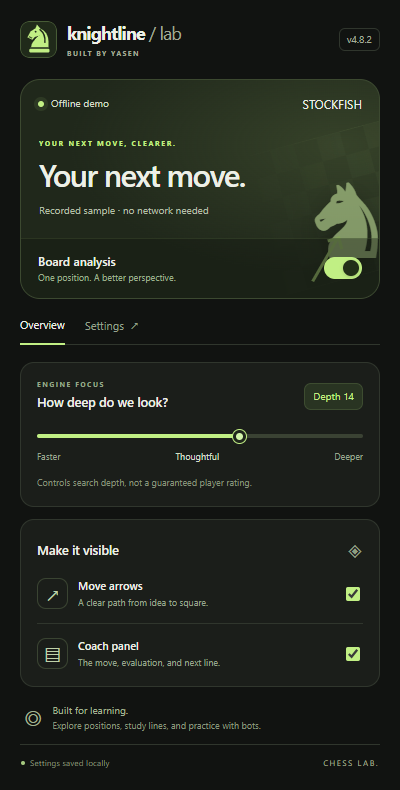
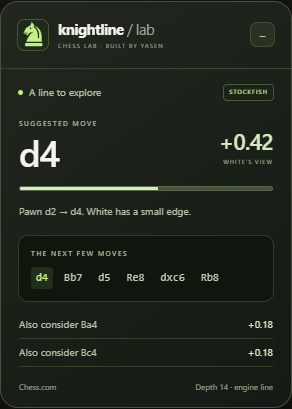

<p align="center">
  
</p>

<p align="center">
  <strong>Manifest V3</strong> &nbsp; · &nbsp; <strong>Chrome & Edge</strong> &nbsp; · &nbsp; <strong>Version 4.8.2</strong> &nbsp; · &nbsp; <a href="LICENSE">Hippocratic 3.0 Core</a>
</p>

<p align="center">
  <a href="#get-started">Install</a> &nbsp; / &nbsp;
  <a href="#see-it-in-action">Preview</a> &nbsp; / &nbsp;
  <a href="#offline-demo">Offline demo</a> &nbsp; / &nbsp;
  <a href="docs/ARCHITECTURE.md">Architecture</a> &nbsp; / &nbsp;
  <a href="PRIVACY.md">Privacy</a>
</p>

# Knightline · Chess Lab

Knightline turns a chess board into a position you can explore. It reads the pieces on Chess.com or Lichess, asks a cloud Stockfish service for a suggestion, checks the returned move against the current position, and draws its path on the board.

The interface stays out of the way: white dashed paths, cyan square highlights, a compact coach panel, and settings that live in your browser. Built by [sixfiguredev0](https://github.com/sixfiguredev0) as a programming-class project.

## See it in action


*The classroom preview uses a simulated engine. The installed extension uses the remote engine service.*

<table>
  <tr>
    <td width="50%" valign="top"><h3>A purposeful popup</h3><p>Adjust search depth, toggle the presentation, and set whose turn it is. Practice controls have their own tab.</p></td>
    <td width="50%" valign="top"><h3>A board companion</h3><p>Read the move in standard notation, inspect the evaluation from White's perspective, and follow the next line. Drag or collapse the panel.</p></td>
  </tr>
</table>

## What it does

- **Makes the suggestion visible.** A dashed path connects highlighted squares without blocking board input. Destination pulses and interface transitions respect reduced-motion preferences.
- **Keeps the position in sync.** Stable-board detection and request identifiers discard responses for positions that have changed.
- **Checks chess rules locally.** The bundled chess.js library validates moves and formats readable SAN continuations. Available FEN metadata and observed history preserve castling and en-passant state.
- **Handles interruptions explicitly.** Loading, missing-board, finished-position, timeout, and retry states replace stale suggestions.
- **Offers controlled practice.** On bots and study boards, optional autoplay uses an ordered delay range. Optional shallow-search practice variations appear in orange.

## Where it runs

| Context | Analysis, suggestions, and arrows | Practice autoplay | Shallow-search variations |
| --- | :---: | :---: | :---: |
| Live games | Yes, on the displayed player's turn | No | No |
| Puzzles and training | Yes | No | No |
| Chess.com Play Computer | Yes | Optional | Optional |
| Analysis and study boards | Yes, for either side | Optional | Optional |

The 4.8 series restores analysis beyond the study-only restriction in the original public version. Version 4.8.2 fixes an engine-compatibility regression after ordinary double-pawn pushes such as `1. e4`: a non-capturable en-passant target is omitted from exported FEN, while genuine legal en-passant captures are preserved. Automated submission remains limited to practice contexts. Use of assistance during human games may violate the host site's rules. Knightline is independent of Chess.com and Lichess and is not endorsed by either service.

## Get started

### Install the extension

1. Download the ZIP from the repository's [Releases](https://github.com/sixfiguredev0/knightline-chess-lab/releases) page and extract it. You can also clone this repository.
2. Open `chrome://extensions` or `edge://extensions` and enable **Developer mode**.
3. Choose **Load unpacked**. Select the extracted extension folder, or the repository root. The selected folder must contain `manifest.json`.
4. Open a supported chess board, open Knightline, and enable **Board analysis**.

**Updating an existing installation:** reload the extension, then refresh your open chess tabs. Loading a different folder may create a separate extension instance with its own settings.

No build step, account, API key, or subscription is required. Real engine analysis needs internet access. Firefox is not supported by this manifest.

### Set the engine focus

The depth slider maps the original internal `elo` setting to requested depths from 8 to 18. It is a search profile, not a calibrated player rating. The coach panel reports the depth actually returned by the provider, which may be lower than requested.

If turn detection needs help, open **Settings → Whose move is it?** and choose a side. A manually imported midgame board without complete FEN metadata cannot reveal historical castling rights; Knightline omits unknown rights rather than inventing them.

### Explore practice variations

On supported practice pages, **Explore alternatives** periodically requests a depth-2 search and displays the result in orange. The interval counts completed analyses. Cancelled or failed requests do not advance it. A shallow search can still find the best move, so an orange move is not guaranteed to be a mistake.

Some boards reject simulated clicks. Practice autoplay checks for a position change and reports rejection; promotion submission is left to the user. Actual bot submission has not been exhaustively verified.

## Offline demo

The full source checkout includes a playable classroom demonstration:

```sh
npm run demo
```

Open [127.0.0.1:4317/analysis](http://127.0.0.1:4317/analysis). Flip the board, trigger an orange practice move, test a connection error, or adjust the popup. The clearly labelled simulated engine needs no account or internet access. Demo browser APIs are separate from the extension and are excluded from release ZIPs.

[Presentation walkthrough →](PRESENTATION.md)

## Development

Node.js 20 or later is recommended. The extension itself has no runtime npm dependencies.

```sh
npm test                 # Unit and local-server security checks
npm install              # Optional browser-test dependency
npx playwright-core install chromium
npm run test:browser     # Offline UI and interaction checks
npm run test:extension   # Real Manifest V3 messaging, using fixtures
npm run test:live        # Public analysis boards and the real provider
npm run package          # Allowlisted, installable extension ZIP
```

You can point `CHROMIUM_PATH` at a compatible installed Chromium executable. Browser tests start fresh profiles. Live checks need network access and do not log into accounts or play human games.

The suite covers legal moves, settings validation, scoring, cancellation, request caching, geometry, popup persistence, live and puzzle page support, practice execution, and browser messaging. See [architecture and testing](docs/ARCHITECTURE.md) for the module map and verification scope.

## Privacy and publication safety

The extension sends position FEN and search options to `https://chess-api.com/v1`. Settings stay in local extension storage. No cookies, usernames, page URLs, or account tokens are included in the request body. The provider still receives normal connection metadata, including the public IP address.

The source and release use explicit publication/package allowlists. Backups, the inspiration extension, local reports, browser profiles, credentials, and environment files are excluded. The local demo serves only its named public assets on the loopback interface.

[Privacy details](PRIVACY.md) · [Security review and reporting](SECURITY.md)

## License and attribution

New Knightline work is available under the [Hippocratic License 3.0 core terms](LICENSE), with copyright and attribution notices in [NOTICE](NOTICE). The licence requires notice retention and restricts specified human-rights abuses. It is an ethical-source licence and does not meet the OSI Open Source Definition. A licence is a legal condition, not a technical barrier against misuse.

Earlier code published as Chess Analysis Engine 4.7.0 remains available under its original MIT grant. That grant is retained in [the legacy notice](docs/licenses/MIT-legacy.txt); it cannot be retroactively revoked. The bundled chess.js rules library remains BSD-2-Clause under [its own licence](lib/LICENSE-chess.js).

The supplied reference informed the dashed overlay and orange practice-move behaviour. Its proprietary account system, backend, extension identity, and update mechanism are not included. Knightline uses the [Chess-API service](https://chess-api.com/) for remote search and [chess.js](https://github.com/jhlywa/chess.js) for local rules.
