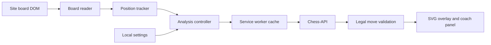

# Architecture and verification

Knightline is a plain JavaScript Manifest V3 extension. It uses a local rules library and a remote engine service. It does not bundle or implement Stockfish.

| Module | Responsibility |
| --- | --- |
| `appSettings.js` | Shared defaults, normalization, and depth profiles |
| `app.js` | Composition root and service wiring |
| `boardReader.js` | Site DOM, piece classes, orientation, turn hints, and available FEN |
| `boardPosition.js` | Position history, legal validation, and SAN conversion |
| `engineController.js` | Request identity and extension messaging |
| `background.js` | Fixed remote endpoint, 15-second timeout, cache, and request deduplication |
| `moveSelectionPolicy.js` | Candidate normalization and selection policies |
| `autoMoveController.js` | Analysis lifecycle and scheduled shallow practice |
| `boardAdapter.js` | Interface between controllers and site interaction |
| `content.js` / `content.css` | Scan coordination, SVG guidance, coach panel, and practice execution |
| `popup.*` | Settings UI and active-tab status |
| `tools/demo-*` | Offline demonstration, excluded from runtime packages |

## The position lifecycle

1. Read logical squares independently from screen orientation.
2. Combine the pieces with complete FEN metadata when available. Otherwise, continue known history or construct a conservative position.
3. Wait for a stable board and dispatch one request for that position.
4. Normalize the provider's move, validate it against the current FEN, and display it.
5. Discard results when a newer request, drag, setting change, or position change invalidates them.

Analysis is available on live, puzzle, bot, and study pages. Move automation and depth-2 practice scheduling have a separate bot/study predicate. Support for one does not enable the other.

## Search and scoring

The internal legacy `elo` setting maps to requested depths 8–18. The returned depth is shown without fabricating a reached depth. Scores are normalized into centipawns for policy comparisons; displayed evaluations remain from White's perspective. A bounded-regret policy reverses its comparison for Black.

The reference-inspired practice scheduler requests depth 2 at a randomly selected interval. The shallow result can match the stronger engine's move. The UI describes a practice variation rather than asserting that it is incorrect.

## Verification layers

- Node tests cover module initialization, settings, candidate normalization, legal moves, history, special moves, cancellation, caching, request privacy, and the local server's asset boundaries.
- Offline browser tests exercise the actual popup and presentation code with a clearly identified simulated engine and playable board.
- Extension tests load Manifest V3 in a fresh Chromium profile and exercise its actual service worker, extension origin, storage events, and messaging. The board and engine are fixtures.
- Live smoke tests inspect the public analysis boards on both supported sites and call the real engine with sample positions. They are integration samples rather than exhaustive site compatibility tests.
- Gitleaks scans the publication tree and all locally fetched Git history. A separate publication check rejects personal filesystem paths, secret files, and unexpected tracked artifacts.

No test establishes that every future site layout will work. Live bot submission, every promotion dialog, and every imported position are outside the completed verification scope.
