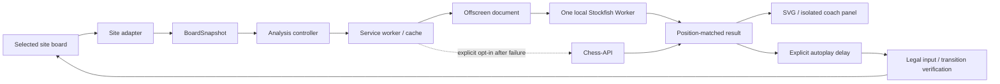

# Architecture

Knightline is a plain JavaScript Manifest V3 extension with a local rules library and bundled Stockfish.js WASM. It has no application server.

## Contracts and identity

`BoardSnapshot` holds the selected board, board/game identity, context, player colour, orientation, turn, FEN, position key, read-only/finished state, reconstruction source and confidence. Request keys include board, game and position. Navigation and rematches invalidate the generation independently of board orientation.

`AnalysisRequest/Result` carries request identity, game and position keys, time/depth budget, three candidate lines, reached depth, typed centipawn or mate scores, and completion status. Scores are normalized to White's perspective. Progress cannot trigger autoplay. Stale progress/final results are discarded.

`ExecutionResult` carries the attempted move, expected/observed FEN when available, acceptance, and explicit rejection/cancellation reasons. A legal one-reply continuation can confirm a submitted move when the opponent replies before the next scan. Click dispatch alone never establishes success.

## Owning modules

| Module | Responsibility |
| --- | --- |
| `appSettings.js` | Versioned settings, migration, normalization, explicit opt-ins |
| `contracts.js` | Keys, typed errors, search/delay budgets, diagnostic redaction |
| `boardReader.js` | Site adapters, board candidates, geometry, history and turn hints |
| `boardPosition.js` | Standard-chess validation, metadata precedence, replay and transitions |
| `engineController.js` | Content-to-broker requests, cancellation and progress filtering |
| `background.js` | One offscreen creation lock, bounded cache, owner routing, opt-in cloud fallback |
| `localEngineHost.js` / `uciProtocol.js` | UCI lifecycle, capabilities, preemption, typed scores, idle release |
| `offscreen.*` | Extension-owned engine host, surviving service-worker suspension |
| `autoMoveController.js` | Legal candidate policy and per-game unique practice opportunities |
| `moveExecutor.js` | Click/drag, all promotion choices, abort signals and transition verification |
| `lichessInputBridge.js` | Narrow MAIN-world Chessground input compatibility |
| `content.js` | Settled snapshots, UI coordination, queue cancellation and diagnostics |
| `panel.css` / `panelStyles.js` | ShadowRoot styles; generated from editable CSS |
| `content.css` | Board overlay styles only |
| `popup.*` | Overview, explicit controls, board selection and private diagnostics |
| `tools/demo-*` | Labelled simulated classroom demo, excluded from runtime packages |

## Reconstruction

Matching complete FEN has priority. Otherwise replay the selected board's SAN history to a matching ply, followed by observed one-ply legal transitions. Generated Lichess move tags are recognized by adjacent SAN groups, then validated by replay against the actual piece placement. Repeated placements with identical chess state but differing counters are disclosed as partial counters.

Without full metadata or usable history, reconstruction requires a detected or manually selected turn and conservatively omits unknown castling/en-passant state. The user can supply a legal complete FEN matching the pieces. It is scoped to that tab and cleared on a piece-placement change. The broker canonicalizes non-capturable en-passant targets before engine submission and diagnostics show both reconstructed and submitted FEN.

## Engine lifecycle

A creation lock prevents duplicate offscreen documents. The offscreen host owns one replaceable Worker, configured for one thread, Hash 32 MB, and MultiPV 3. New requests stop obsolete searches; a bounded stop timeout destroys an unresponsive Worker. Local errors are retried once. Worker errors and service-worker restarts are recoverable. No fallback position is transmitted unless cloud fallback was explicitly enabled.

Active/visible board work takes priority; hidden tabs stop obsolete analysis. The worker is terminated after 60 idle seconds. The extension does not enable pondering or background game execution.

## Verification boundaries

The deterministic integration suite uses actual MV3 content scripts and actual WASM on controlled site-markup fixtures. Move-input regressions cover full short games, both colours, click/drag, castling, en passant and promotions. Public-site tests are separate and use fresh anonymous profiles. Neither suite substitutes for the user's affected installed extension or controlled account games. See [ACCEPTANCE.md](ACCEPTANCE.md).
